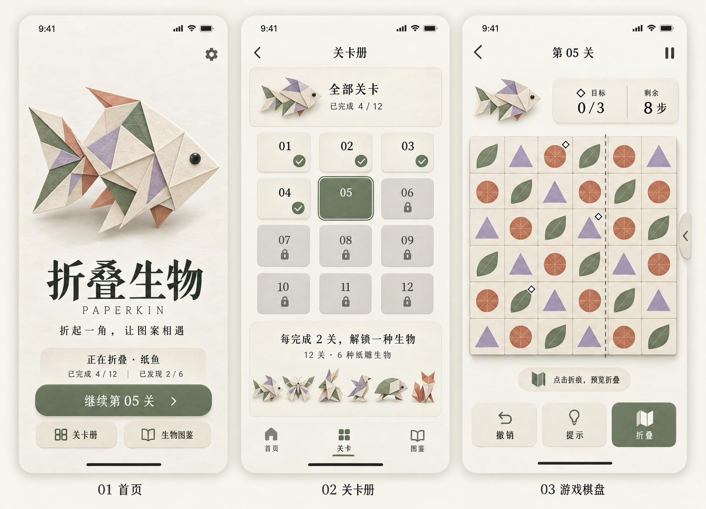
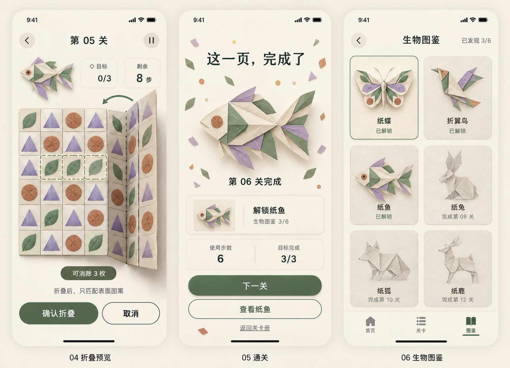

# 折叠生物首版上线资料

> 2026-10-16 实现更新：用户已将产品方向调整为娱乐优先。当前首页以无需通关的纸间花园为主，支持六种生物自由展示、光色切换、位置与大小调整、互动及本地布置恢复；原 12 关和挑战图鉴独立保留。主要类别准备为 Entertainment，次要类别 Games / Puzzle，尚未提交到 App Store Connect。下文保留原始规划基线；最新实现与上架资料见 [开发交接](../../artifacts/CFV-Developer-Guide.txt) 和 [商店文案](../../artifacts/release-materials/CFV-Store-Copy-zh-Hans.txt)。

版本：1.0 规划基线 修订2  
整理日期：2026年10月15日  
项目：Crealfanvar  
产品暂定名：折叠生物  
英文暂定名：Paperkin

首版围绕“交换图案与折叠纸面共同完成三消”展开，提供 12 个手工关卡和 6 种纸雕生物，每完成 2 关解锁一种。全部关卡在同一个关卡册展示，按每 4 关划分为三个学习阶段，不设独立章节入口。采用免费、离线、无账号、无广告、无内购的发布基线，交付完整的游玩、解锁、收藏、设置与恢复流程。

本资料用于进入正式开发和上线验收。已完成的交付是产品文档、六屏静态视觉原型、交互规范、技术设计、规则样例及发布清单；应用实现、12 关制作、真机验证和 App Store 提审尚未完成。原型不是可运行程序，也不是最终商店截图。

## 阅读顺序

| 资料 | 用途 |
| --- | --- |
| [产品方案](01-Product-Plan.md) | 产品定位、完整首版范围、精确玩法、关卡规划和验收目标 |
| [原型与交互规范](02-UX-Spec.md) | 六屏高清原型、页面流程、控件状态、异常状态与美术交付 |
| [技术方案](03-Technical-Plan.md) | UIKit 架构、折叠计算、动画、存档、提示和测试设计 |
| [上线与验收清单](04-Launch-Checklist.md) | 开发里程碑、测试矩阵、提审材料和发布条件 |
| [规则样例](examples/CFV-Fold-Example.json) | 单次折叠可完成的确定性示例，供规则实现对照 |
| [首版内容目录](examples/CFV-Release-Catalog.json) | 12 关顺序、学习阶段和 6 种生物的解锁映射，作为实现输入基线 |
| [图片生成提示词](prototypes/CFV-Paperkin-Image-Prompts-v2.txt) | 两张原型图使用的完整提示词，生成方式为内置 imagegen |

## 首版范围

| 项目 | 约定 |
| --- | --- |
| 玩法 | 6×6 固定棋盘，3 种图案，交换三消，水平或垂直单折面 |
| 内容 | 12 关，3 个学习阶段各 4 关；6 种生物，每完成 2 关解锁一种 |
| 能力 | 教学、折叠预览、撤销、提示、重玩、断点续玩、图鉴、设置 |
| 收费 | 免费完整首版，无体力和消耗品 |
| 平台 | iPhone 竖屏，沿用 App Target 的 iOS 15.0 最低版本 |
| 语言 | 简体中文及英文；中文原型为视觉基准 |
| 技术 | Swift、UIKit、Core Animation、AVFoundation、本地 JSON |
| 依赖 | 首版零第三方运行时依赖 |
| 存档 | 本地保存；换设备同步不在首版范围 |
| 发布范围 | 开发者在提审前确定地区，按所选地区补齐适用材料 |

免费发布、名称和地区属于本次规划基线或待发布决策，不代表已经修改商店配置。保留现有 Bundle ID、签名团队和发布配置。

## 六屏原型

首页、关卡册与正常棋盘：

折叠预览、通关与生物图鉴：

图片展示视觉、布局和交互意图。目标标记、图标、棋盘图案及可解性以交互规范和规则样例为准，正式开发由同一份关卡数据驱动界面与逻辑。

## 开发交付顺序

1. 实现并验证规则引擎和一个完整折叠关卡。
2. 完成六个主页面、辅助流程、存档和设置。
3. 完成全部 12 关、六种生物及中英文内容。
4. 完成真机与 TestFlight 验收，准备实际应用截图及商店资料。
5. 核验发布前置条件，提审并处理真实审核反馈。

首版上线以第四份文档的发布门槛为准，前 4 关只作为内部验证节点。生物解锁顺序为第 02 关纸蝶、第 04 关折翼鸟、第 06 关纸鱼、第 08 关纸兔、第 10 关纸狐、第 12 关纸鹿。

## 资料检查结果

本地文档链接已检查，引用的原型与样例文件均存在。当前原型为修订2，首页总进度为 4/12、已有收藏为 2/6；第 06 关通关解锁纸鱼，图鉴为 3/6。旧稿保存在项目归档目录，不纳入当前交付包。

内容目录已验证：12 个关卡 ID 唯一，六组两关制作段完整覆盖全部关卡，解锁节点为 02、04、06、08、10、12。已核对从完成 0 关到完成 12 关的全部 13 个进度状态，以及重复通关和缺少前置关时的收藏结果。该检查针对规划数据，不代表应用功能已实现。

规则样例已用独立参考计算验证：初始无自然匹配，右侧两列折叠后产生四连，消除两枚目标棋子，被遮住的两枚棋子保留，最后一步正确判定通关。此检查验证样例计算，不代表尚未实现的 Swift 引擎、正式 12 关或应用性能已经通过测试。
